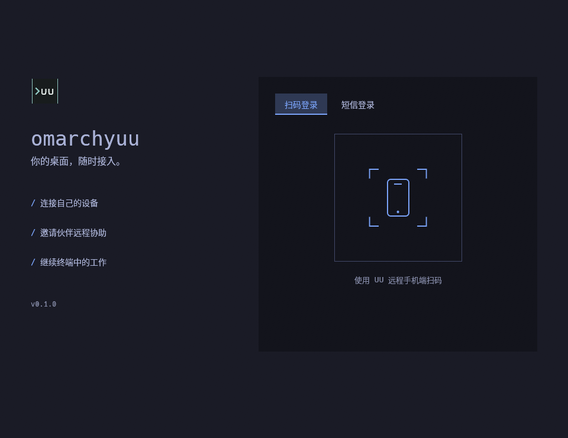
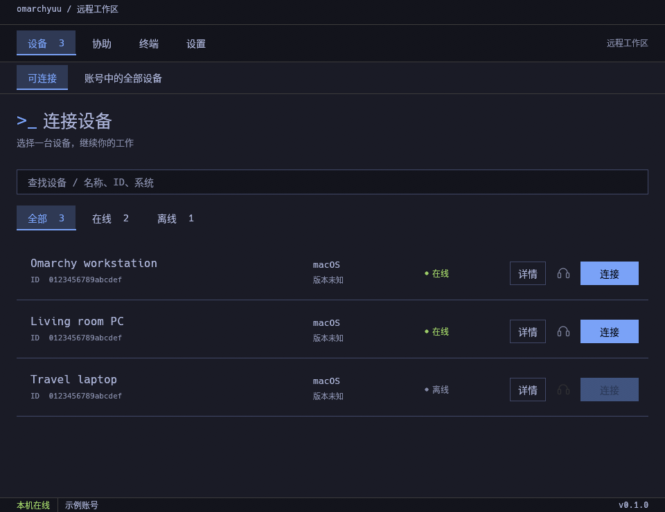
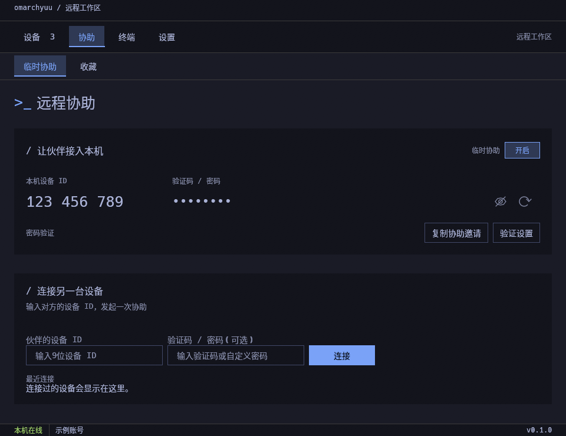
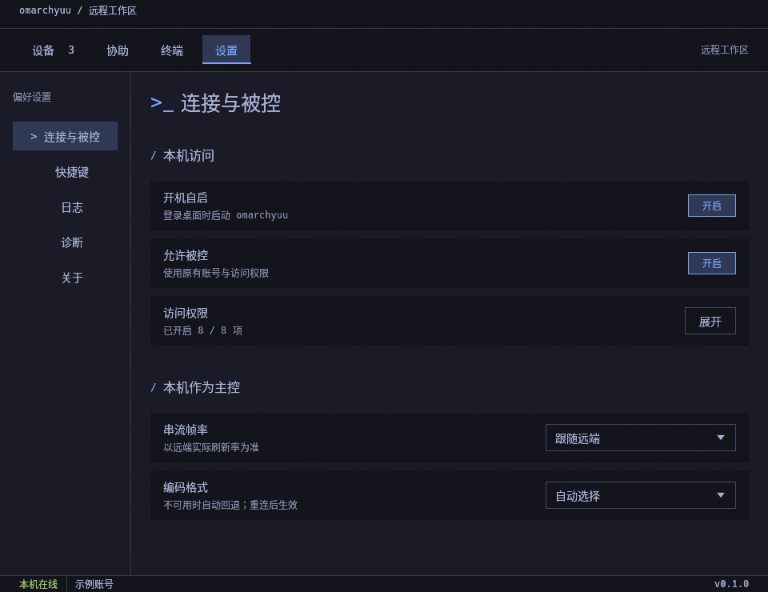

# omarchyuu


为 **Omarchy** 打造的非官方 UU 远程桌面客户端。

使用 Rust + egui 开发，兼容 UU 远程客户端，支持连接远程设备和接受远程控制。紧凑的工作区界面，自动跟随 Omarchy 当前主题。

## 功能支持

### 已支持

- **远程控制**：键鼠控制、多物理显示器切换、画质与帧率调节（H.264 硬件编解码）。
- **远程协助**：同账号设备直连、协助码与验证码连接、邀请链接接入。
- **文件管理**：主控端独立双栏文件管理器（支持双向浏览、上传与下载）。
- **音频与终端**：被控端桌面声音监听、仅音频连接、本机终端与 UU 手机端终端。
- **系统集成**：TCP / UDP 端口转发、Omarchy 主题实时跟随（运行中切换主题无需重启）、系统托盘、开机自启。

### 暂不支持或受限

- **剪贴板互通 / 桌面拖拽传文件**：不支持（受 Wayland 安全限制，传文件请用独立文件传输）。
- **被控端主动推送文件**：不支持（遵循远控安全模型，需在主控端发起上传或下载）。
- **游戏鼠标视角锁定**：受限（Hyprland 等桌面下指针锁定易失效，会自动回退为普通鼠标）。
- **语音通话 / 麦克风重定向**：不支持（目前无 Linux 虚拟麦克风支持）。
- **虚拟扩展副屏**：仅 niri 桌面支持，Hyprland 暂不支持。
- **其他高级特性**：白板批注、插件系统、H.265 硬解、HDR 画面。

## 安装

### Pacman 仓库（推荐）

适用于 Omarchy / Arch Linux（x86_64）。在 `/etc/pacman.conf` 末尾添加一次：

```ini
[omarchyuu]
SigLevel = Optional
Server = https://keatsyh.github.io/omarchyuu/$arch
```

然后安装：

```bash
sudo pacman -Syu omarchyuu-bin
```

配置后也可以使用 `yay` 或 `paru`：

```bash
yay -S omarchyuu-bin
# 或
paru -S omarchyuu-bin
```

后续随 `sudo pacman -Syu` 或 `yay -Syu` 更新，无需本地编译。仓库通过 HTTPS 分发，目前未提供 PGP 签名；上面的签名设置仅作用于 `[omarchyuu]` 仓库。

### 归档安装

从 [Releases](https://github.com/keatsyh/omarchyuu/releases/latest) 下载 Linux 归档，解压后运行：

```bash
tar --zstd -xf omarchyuu-0.1.1-x86_64-linux.tar.zst
cd omarchyuu-0.1.1-x86_64-linux
./install-omarchy.sh
```

安装完成后，从应用菜单打开 **omarchyuu**，或运行 `omarchyuu`。

## 使用

以下为界面示意，账号、设备及协助信息均为示例。

### 登录

使用 UU 远程手机端扫码，或切换到短信登录。



### 连接设备

在「设备」中找到在线设备，点击「连接」。



### 远程协助

在「协助」中输入对方的设备 ID 和验证码，或复制本机的协助邀请发给对方。



### 允许本机被控

在「设置 → 连接与被控」中开启「允许被控」，按需开放访问权限；需要自动运行时开启「开机自启」。



## 开发者

### 从源码构建

需要 Rust stable。Omarchy / Arch Linux 的构建依赖：

```bash
sudo pacman -S --needed base-devel rust cmake clang nasm pkgconf \
  libva alsa-lib dbus openssl fuse3 noto-fonts-cjk gnome-keyring \
  libx11 libxcb libxrandr libxi libxcursor libxfixes \
  libxkbcommon libxkbcommon-x11 wayland xorg-xwayland libglvnd vulkan-icd-loader
```

在仓库根目录构建并运行：

```bash
cargo build --release --locked --bin omarchyuu
./target/release/omarchyuu
```

<details>
<summary>测试与辅助程序</summary>

运行回归测试（硬件和桌面相关测试需单独执行）：

```bash
cargo test --release --locked --lib -- --test-threads=1
```

可选的虚拟显示器辅助程序：

```bash
cargo build --release --locked --manifest-path crates/vkms/Cargo.toml --target-dir target
```

</details>

## 致谢与许可证

基于 **OpenUUYC** 继续开发，感谢原作者 **djkcyl** 及相关第三方项目。

本项目沿用上游的自定义许可，并非 MIT / GPL 等通用开源许可。详见 [LICENSE](LICENSE) 与 [第三方声明](THIRD_PARTY_NOTICES)。
